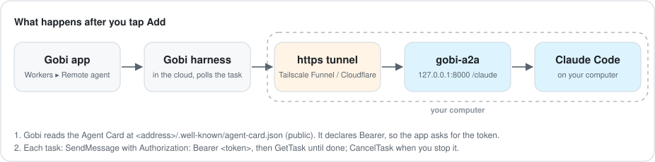
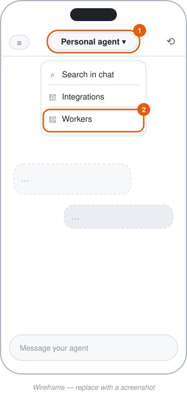
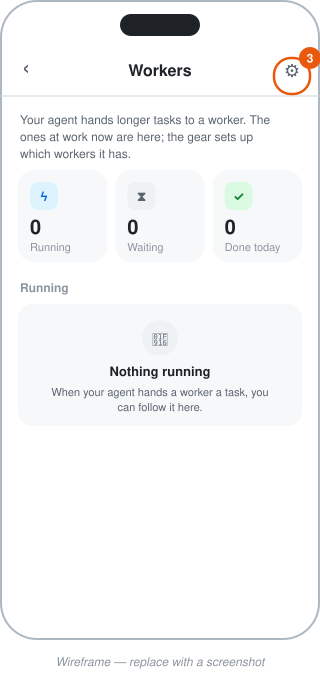
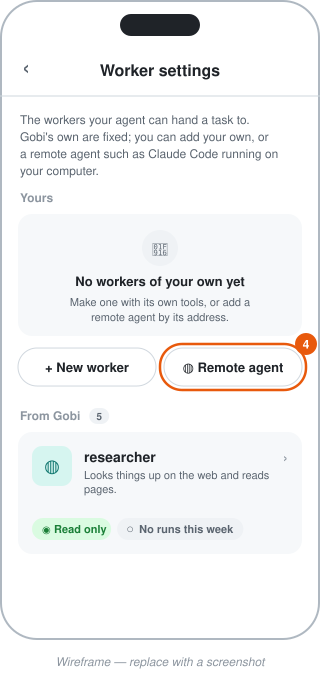
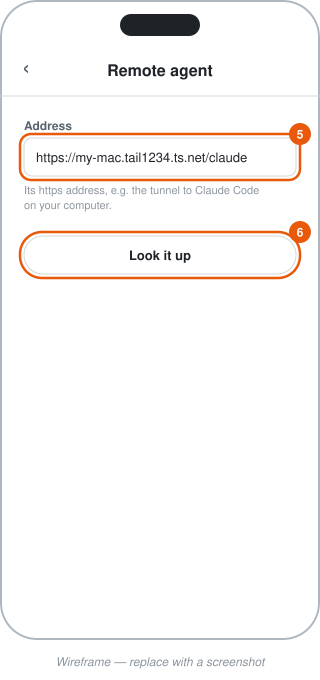
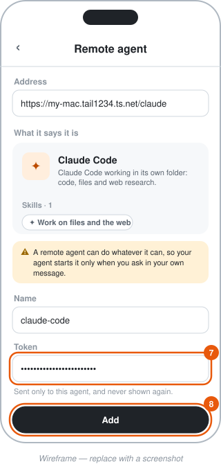
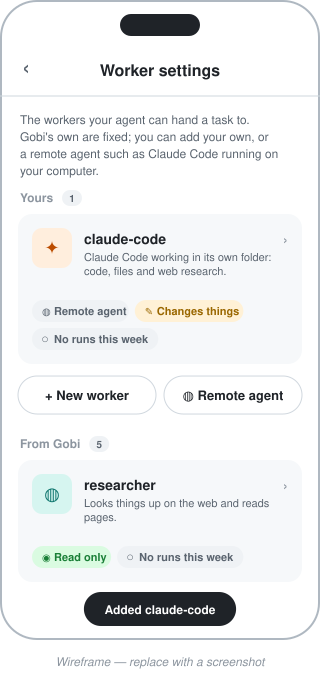
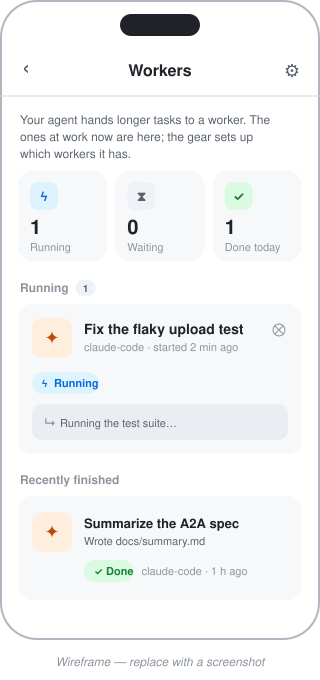

# gobi-a2a

One gateway in front of several coding agents, each an [A2A (Agent2Agent)](https://a2a-protocol.org) server a
Gobi harness (`gobi-harness`) can hand work to. A2A is the open, vendor-neutral standard for agent-to-agent
communication, hosted by the Linux Foundation's Agentic AI Foundation; this gateway implements **A2A 1.0**, documented in
**[docs/protocol.md](docs/protocol.md)**. One process, one port, one tunnel, one config file (`a2a.yaml`). Each
agent is mounted under its own name:

| Agent | Path | What it runs | State |
|---|---|---|---|
| `claude` | `/claude` | Claude Code, through the Claude Agent SDK | **on by default**, complete (formerly `gobi-harness/a2a/claude`) |
| `cursor` | `/cursor` | Cursor's agent CLI (`cursor-agent --print`) | scaffold, off by default |
| `aider` | `/aider` | Aider (`aider --message`) | scaffold, off by default |
| `omp` | `/omp` | omp, oh-my-pi (`omp -p`) | scaffold, off by default |

The Gobi app takes one **address** per worker. With the gateway, each agent's address is `https://<your-domain>/<agent>`,
for example `https://my-mac.tail1234.ts.net/claude` behind Tailscale Funnel. All agents can sit behind the same tunnel
and token; [Quick start](#quick-start) sets one up with Tailscale Funnel or Cloudflare Tunnel, and
[Connecting to Gobi App](#connecting-to-gobi-app) adds it in the app, screen by screen.

## The A2A protocol

**A2A (Agent2Agent) is an open standard for agents to talk to each other.** Google introduced it in 2025 and donated
it to the Linux Foundation; since August 2026 it is a hosted project of the Linux Foundation's **Agentic AI Foundation
(AAIF)**, alongside MCP. The specification and SDKs are at **<https://a2a-protocol.org>** and
<https://github.com/a2aproject>. Nothing about it is Gobi-specific. Any A2A client can call the agents behind this gateway, and a Gobi harness can call any A2A agent,
whoever built it and whatever it is written in.

The full reference is **[docs/protocol.md](docs/protocol.md)**: every endpoint, every request and response as captured
from this gateway, the task lifecycle, errors, the REST binding, and how to build a third-party agent. In short, this
gateway speaks A2A **1.0** over **JSON-RPC 2.0**:

| | How |
|---|---|
| **Discovery** | `GET /<agent>/.well-known/agent-card.json`: the Agent Card, public. Its name, description, skills, where to send work (`<public_url>/<agent>/`), and that it wants HTTP Bearer ([§5](docs/protocol.md#5-the-agent-card)) |
| **Every call** | `POST /<agent>/`, headers `Authorization: Bearer <token>` and **`A2A-Version: 1.0`** (required: without it the call fails with `-32009`), body `{"jsonrpc": "2.0", "id": ..., "method": ..., "params": ...}` ([§3](docs/protocol.md#3-transport-http-headers-json-rpc-envelope)) |
| **Task creation** | `SendMessage` with a new message. `configuration.returnImmediately: true` answers at once with the task in `SUBMITTED`. A `contextId` continues a conversation: same folder, same Claude session ([§7.1](docs/protocol.md#71-sendmessage-create-a-task-continue-a-conversation-or-steer-a-task)) |
| **Polling** | `GetTask {id}` until the state is terminal. `status.message` is the latest progress note, then the final answer ([§7.3](docs/protocol.md#73-gettask-poll-a-task), [§8.3](docs/protocol.md#83-polling)) |
| **Streaming** | `SendStreamingMessage` / `SubscribeToTask`: Server-Sent Events, each `data:` line a JSON-RPC response carrying a `task`, `statusUpdate` or `artifactUpdate` ([§7.2](docs/protocol.md#72-sendstreamingmessage-create-a-task-and-stream-it)) |
| **Steering** | `SendMessage` with the running task's `taskId`. It is queued and runs when the current run ends, on the same session ([§8.5](docs/protocol.md#85-steering)) |
| **Cancellation** | `CancelTask {id}` stops the run; the task becomes `CANCELED` ([§8.6](docs/protocol.md#86-cancellation)) |
| **Model and effort** | `{"model": ..., "effort": "low"\|...\|"max"}` in the message's metadata, for that run only ([§9.1](docs/protocol.md#91-in-choosing-the-model-and-effort-for-one-run)) |
| **Cost** | `cost_usd`, `usage`, `turns`, `model`, `effort` in the final status message's metadata ([§9.2](docs/protocol.md#92-out-what-the-run-cost)) |

Method names are A2A 1.0's (`SendMessage`, `GetTask`, ...). The slash names of pre-1.0 drafts (`tasks/send`,
`tasks/get`, `message/send`, ...) are not served and get `-32601`; the mapping is in
[§7.8](docs/protocol.md#78-method-names-from-earlier-versions-taskssend-tasksget-).

Task states: `SUBMITTED` → `WORKING` → `COMPLETED` | `FAILED` | `CANCELED`, or `SUBMITTED` → `REJECTED` when a task
is refused before it runs ([§8](docs/protocol.md#8-task-lifecycle)).

**Building your own agent** for Gobi, in any language: [§12](docs/protocol.md#12-implementing-a-third-party-agent)
lists what the harness needs. [`examples/echo_agent.py`](examples/echo_agent.py) is a complete standalone agent of
about 100 lines, on the open-source A2A SDK alone, and `tests/test_protocol.py` checks it the way the harness calls it.

## Quick start

**1. Install and configure.**

```sh
git clone https://github.com/gobi-ai/gobi-a2a && cd gobi-a2a
uv sync                                   # or: uv venv && uv pip install -e .
cp a2a.example.yaml a2a.yaml              # a2a.yaml is git-ignored: it is yours
export A2A_TOKEN=$(.venv/bin/gobi-a2a token)    # Gobi presents this; keep it
```

**2. Give the gateway a public https address.** Gobi's harness runs in the cloud and only calls public `https://`
addresses, so port 8000 on this machine needs a tunnel. Pick one:

**Tailscale Funnel (recommended): a permanent HTTPS address on your tailnet.**

```sh
tailscale funnel --bg 8000                # https://<machine>.<tailnet>.ts.net -> localhost:8000, kept running
tailscale funnel status                   # prints the address
```

- The address is your machine's MagicDNS name, with a real certificate, and it **never changes**, so the worker's
  address in the Gobi app stays valid across restarts and reboots.
- The first run asks you to turn on HTTPS and Funnel for the tailnet (one click in the admin console). `--bg` keeps it
  up until `tailscale funnel --bg 8000 off`. Without `--bg` it runs in the foreground, exactly `tailscale funnel 8000`.
- Funnel is the public half of Tailscale. The machine stays on your private tailnet, so you can also reach the
  gateway from your other devices at the same name. `tailscale serve --bg 8000` exposes it to the tailnet **only**:
  fine for your own A2A clients, but Gobi cannot reach a tailnet-only address.

**Cloudflare Tunnel: free, no account, no interstitial pages.**

```sh
cloudflared tunnel --url http://localhost:8000    # prints https://<random-words>.trycloudflare.com
```

- Nothing to sign up for, nothing to pay, and no browser warning page in front of your agents (unlike ngrok's free
  plan): the Agent Card and every call reach the gateway as sent.
- This *quick tunnel* gets a new random address each time it starts, so update `A2A_PUBLIC_URL` and the worker's
  address in the app after each restart. Quick tunnels also do not carry Server-Sent Events, so `SendStreamingMessage`
  and `SubscribeToTask` will not work through one. The Gobi harness only polls, so it does not need them.
- For a fixed address on your own domain, with streaming, use a
  [named tunnel](https://developers.cloudflare.com/cloudflare-one/networks/connectors/cloudflare-tunnel/) instead
  (also free).

Any other https tunnel works the same way, ngrok included.

**3. Start the gateway** with the address from step 2:

```sh
export A2A_PUBLIC_URL=https://<machine>.<tailnet>.ts.net   # or https://<random-words>.trycloudflare.com
.venv/bin/gobi-a2a                                         # listens on 127.0.0.1:8000
```

From another terminal, check it end to end through the tunnel. The card is public and names
`$A2A_PUBLIC_URL/claude/` as where to send work:

```sh
curl -s https://<machine>.<tailnet>.ts.net/claude/.well-known/agent-card.json
```

**4. Add the agents in Gobi.** In the Gobi app, open your personal agent's **Workers** ▸ gear ▸ **Remote agent**, and
add `<A2A_PUBLIC_URL>/claude` (for example `https://my-mac.tail1234.ts.net/claude`) and the token. Do the same for
each other agent you enable (`/cursor`, `/aider`, `/omp`), with the same token unless you gave that agent its own.
[Connecting to Gobi App](#connecting-to-gobi-app) walks through it screen by screen.

Claude Code signs in as it does on this machine (`ANTHROPIC_API_KEY`, or its own login), and the run's cost is on that
account. The CLI agents sign in the same way their programs do on this machine.

## Connecting to Gobi App

Once the gateway is running and reachable through its tunnel ([Quick start](#quick-start) steps 1 to 3), add each
agent to your Gobi personal agent as a **Remote agent** worker. You need two things:

| | Value | Example |
|---|---|---|
| **Address** | `<A2A_PUBLIC_URL>/<agent>` | `https://my-mac.tail1234.ts.net/claude` |
| **Token** | the gateway's bearer token, `$A2A_TOKEN` (from `gobi-a2a token`) | `echo $A2A_TOKEN` |

Before you open the app, check that the Agent Card answers through the tunnel. If this fails, the app's look-up
will fail the same way:

```sh
curl -s https://<machine>.<tailnet>.ts.net/claude/.well-known/agent-card.json
```

<p align="center"></p>

### Step by step

The numbers match the callouts on the screens below. The screens are wireframes of the app's Workers pages
([gobi-app#1147](https://github.com/gobi-ai/gobi-app/pull/1147)); [docs/images/](docs/images/README.md) says how to
swap in real screenshots.

**Open Workers from your personal agent**

1. Open the **Personal agent** chat and tap the **title pill** at the top center (it shows your agent's name, or
   *Personal agent*). The agent's menu opens under it.
2. Tap **Workers**. It is only in the menu of your own personal agent chat.
3. On **Workers**, tap the **gear** at the top right: **Worker settings**.
4. Under **Yours**, tap **Remote agent**.

<table>
  <tr>
    <td align="center"><br><sub>1–2 · Title pill ▸ Workers</sub></td>
    <td align="center"><br><sub>3 · Workers ▸ gear</sub></td>
    <td align="center"><br><sub>4 · Worker settings ▸ Remote agent</sub></td>
  </tr>
</table>

**Add the agent**

5. In **Address**, enter the agent's address: `https://<machine>.<tailnet>.ts.net/claude` with Tailscale Funnel, or
   `https://<random-words>.trycloudflare.com/claude` with a Cloudflare quick tunnel. Include the agent's path
   (`/claude`, `/cursor`, ...): the bare domain is the gateway itself, not an agent, and has no Agent Card.
6. Tap **Look it up**. Gobi reads the agent's public Agent Card and shows **What it says it is**: *Claude Code*, its
   description and skill, and a **Changes things** badge. A remote agent can do whatever it can on your computer, so
   your agent starts it only when you ask for it in your own message.
7. Check the **Name** (filled in from the card, e.g. `claude-code`; lowercase letters, digits and hyphens, starting
   with a letter). It is how your agent and the Workers page refer to it. Then paste your **Token**, the value of
   `$A2A_TOKEN`. It is sent only to this agent and never shown again. The Token field appears because the card
   declares HTTP Bearer; with `no_auth: true` there is none.
8. Tap **Add**. A toast says *Added claude-code*, and the agent is listed under **Yours** in Worker settings.

<table>
  <tr>
    <td align="center"><br><sub>5–6 · Address ▸ Look it up</sub></td>
    <td align="center"><br><sub>7–8 · Token ▸ Add</sub></td>
    <td align="center"><br><sub>Added under Yours</sub></td>
  </tr>
</table>

Repeat steps 4 to 8 for each other agent you enabled (`/cursor`, `/aider`, `/omp`), with the same token unless you
gave that agent its own `token:` in `a2a.yaml`.

### Using it

- **Ask for it by name.** Your agent hands work to a remote agent only when your own message asks for it, for example
  *"Have claude-code fix the flaky upload test in ~/src/app"*. Each task is one A2A `SendMessage`; Gobi then polls it
  with `GetTask` (see [How Gobi Harness connects](#how-gobi-harness-connects)).
- **Watch it on Workers.** While it works, the task is under **Running**, with the worker's name, when it started and
  its latest progress line. Tapping a running task asks *Stop this worker?*; **Stop** sends `CancelTask`. The last
  five that ended are under **Recently finished**, each with how it ended and its summary.
- **Edit or remove it** from **Worker settings**: tap the worker. Its page shows this week's runs. **Enter it again**
  replaces the token, **Read its card again** saves and re-reads the card (after you rename the agent or change its
  description in `a2a.yaml`), and **Remove** deletes it. The address cannot be edited: if it changes (a Cloudflare
  quick tunnel gets a new one on each start), remove the worker and add it again with the new address.

<p align="center"><br><sub>Workers while claude-code is at work</sub></p>

### If it does not connect

| What you see | Why, and what to do |
|---|---|
| *Could not read the agent's card* after **Look it up** | The app could not fetch `<address>/.well-known/agent-card.json`. Run the `curl` above. Check that the gateway is running, the tunnel is up (`tailscale funnel status`), the address ends in the agent's path, and that agent is `enabled: true`. `tailscale serve` is tailnet-only: Gobi needs `tailscale funnel`. |
| The card names the wrong address | `A2A_PUBLIC_URL` was not set, or was set to another address, when the gateway started. The card tells Gobi where to send work, so set it to the tunnel's `https://` URL and restart the gateway. |
| No **Token** field | The gateway runs with `no_auth: true`. Never expose that through a tunnel: set a token and restart. |
| Tasks fail, or the worker shows **CHECK** | Open the worker in Worker settings: the page says what needs attention. A `401` means the token Gobi holds is not the one the gateway expects (the gateway's `token`, or the agent's own `token:` in `a2a.yaml`). Tap **Enter it again** and paste the current one. |
| It worked, then stopped after a restart | With a Cloudflare quick tunnel the address changed: update `A2A_PUBLIC_URL`, restart the gateway, then remove the worker and add it again. A Tailscale Funnel address does not change. |

## The command

```sh
gobi-a2a [serve] [-c a2a.yaml] [--host H] [--port P]   # start the gateway (serve is the default)
gobi-a2a check   [-c a2a.yaml]                         # check the config; print each agent's address and settings
gobi-a2a token                                         # print a new random bearer token
python -m gobi_a2a ...                                 # the same
```

The config is `-c/--config`, else `$GOBI_A2A_CONFIG`, else `./a2a.yaml`. A mistake in it (an unknown key or agent, a
bad value) stops the gateway at start and names the key, so a typo cannot pass silently.

## Configuration: `a2a.yaml`

[`a2a.example.yaml`](a2a.example.yaml) is the full, commented reference. In short:

```yaml
gateway:
  host: 127.0.0.1
  port: 8000
  public_url: ${A2A_PUBLIC_URL}   # what the Agent Cards name; unset: http://host:port
  token: ${A2A_TOKEN}             # the bearer token callers present
  no_auth: false                  # true: no token at all. Local testing only, never behind a tunnel
  workdir: ./work                 # <workdir>/<agent>/<conversation>/
  log_level: info

agents:
  claude:
    enabled: true
    model: claude-opus-5-5
    permission_mode: default
  cursor:
    enabled: false
```

- **Environment references.** Any string may say `${NAME}` or `${NAME:-fallback}`. Keep the token in the environment
  (or a secret manager) rather than in the file. An unset variable is empty, and an empty value means the same as
  leaving the key out, so the default applies.
- **Paths.** Relative paths start at the config file's folder; `~` works.
- **Per-agent fields every agent has.** `enabled`, `name` and `description` (what its Agent Card says; the harness
  shows the description to its super agent), `token` (its own bearer token in place of the gateway's), and `workdir`
  (in place of `<gateway.workdir>/<agent>`).

### `claude`

| Key | Default | |
|---|---|---|
| `model` | `claude-opus-5-5` | a message may pick another (below) |
| `effort` | none (Claude Code's default) | `low`, `medium`, `high`, `xhigh` or `max`; a message may pick another |
| `thinking` | none (Claude Code's default, adaptive on Opus) | `adaptive`, `disabled`, or a token budget such as `16000` |
| `allowed_tools` | `[Read, Glob, Grep, Write, Edit, WebSearch, WebFetch]` | the tools that run without asking; others are refused. **No Bash** |
| `permission_mode` | `default` | `default`, `acceptEdits`, `plan`, `bypassPermissions`, `dontAsk` or `auto` |
| `max_turns` | none (**no limit**) | an optional cap on turns per run |
| `system_prompt` | none | added to Claude Code's own |

Nobody is there to approve a tool, so only `allowed_tools` run. With `permission_mode: bypassPermissions`, **every tool
runs, Bash included, whatever `allowed_tools` says.** Use it only where Claude may do anything the account running the
gateway can, such as a container or a dedicated machine. To switch it, edit `a2a.yaml` and restart the gateway
(Ctrl-C, then `gobi-a2a`). The tunnel can stay up.

### `cursor`, `aider`, `omp` (scaffolds)

Each runs its command line program once per task, in that conversation's folder. Each line the program prints is a
progress note, and what it printed is the result when it exits 0. Any other exit fails the task with the end of its
stderr. A cancel stops the process (SIGTERM, then SIGKILL).

| Key | |
|---|---|
| `command` | argv list, never a shell line. `"{prompt}"` is replaced by the task's text; without one, the text is appended as the last argument |
| `model`, `model_args` | the default model, and the flags that pass one (`[--model, "{model}"]`), added only when a model is set here or by the message |
| `effort`, `effort_args` | the same for effort (omp: `[--thinking, "{effort}"]`) |
| `timeout` | seconds per run; empty: no limit |
| `env` | variables added for the run, e.g. `CURSOR_API_KEY: ${CURSOR_API_KEY}` |

The defaults:

- **cursor:** `cursor-agent --print --output-format text <prompt>`. In print mode Cursor may refuse to change files or
  run commands. Add `--force` to `command` where that is safe; it is Cursor's counterpart to `bypassPermissions`.
- **aider:** `aider --yes-always --no-pretty --no-stream --no-check-update --message <prompt>`. Aider keeps a git repo
  and its chat history in the folder. Add `--restore-chat-history` to carry a conversation on.
- **omp:** `omp -p <prompt>`. The flags follow the pi coding agent's CLI. Check `omp --help` and adjust `command`,
  `model_args` and `effort_args` if your version differs (pi's thinking levels stop at `xhigh`).

The gateway starts even if a program is not installed. It logs a warning, and that agent's tasks fail with
"not installed".

## How Gobi Harness connects

The harness (`gobi-harness/engine/a2a.py`) is given an address and nothing else:

1. It reads the **Agent Card** at `<address>/.well-known/agent-card.json`, for example
   `https://my-mac.tail1234.ts.net/claude/.well-known/agent-card.json`. Cards are **public**, so the harness can read one before
   it has a credential. Each card declares HTTP Bearer, so the app asks for the token.
2. It sends work to the JSON-RPC URL the card names. The gateway always names `<public_url>/<agent>/` (with the
   trailing slash, because the harness does not follow redirects). Each brief is one A2A message (protocol 1.0,
   `SendMessage` with `returnImmediately`). The harness then polls the task with `GetTask`, sends steers to the same
   task, and calls `CancelTask` on kill.
3. The final status message's metadata carries the run's cost (`cost_usd`, `usage`, `turns`, `model`, `effort`), and
   the harness adds it to the worker's use.

`public_url` must therefore be the URL the harness actually reaches, meaning your tunnel's `https://` URL. The harness
only talks to public https addresses. A Tailscale Funnel address never changes. If yours does (a Cloudflare quick tunnel gets a new one on each
start), update `A2A_PUBLIC_URL`, restart, and edit the worker's address in the app.

The exact calls, headers and limits the harness uses (60 s per call, 2 MB per answer, polling every 2 to 15 s) are in
[docs/protocol.md §12.1](docs/protocol.md#121-what-a-gobi-harness-needs-from-an-agent).

## Model and effort per task

`model` and `effort` in `a2a.yaml` are defaults. A message can name its own for the run it starts, in its metadata.
The request's metadata works too, and the message's wins:

```json
{"message": {"messageId": "m-1", "role": "ROLE_USER", "parts": [{"text": "..."}],
             "metadata": {"model": "claude-sonnet-5", "effort": "low"}}}
```

A follow-up in the same context, or a steer sent to the task itself, resumes the same Claude session on whatever it
names. Anything it leaves out falls back to the server's default, not to what the previous run used. The Gobi harness
sends the ticket's current choice with every message. A model that is not a model name, or an effort other than `low`,
`medium`, `high`, `xhigh` or `max`, rejects the task before anything runs. The final status message says which model
and effort ran. The CLI scaffolds take the same `model` and `effort` metadata and pass it through
`model_args`/`effort_args`.

## Endpoints

| | Auth | |
|---|---|---|
| `GET /healthz` | public | `{"status": "ok"}` |
| `GET /` | gateway token | the gateway, its enabled agents (address, endpoint, card URL, auth) and which are disabled |
| `GET /v1/agents` | gateway token | the enabled agents, each with its full Agent Card |
| `GET /<agent>/.well-known/agent-card.json` | public | the agent's card |
| `POST /<agent>/` | the agent's token | A2A JSON-RPC: `SendMessage`, `SendStreamingMessage`, `GetTask`, `CancelTask`, ... |

Tokens are compared in constant time. A wrong or missing one gets `401` with `WWW-Authenticate: Bearer`. A2A calls
also need the header `A2A-Version: 1.0`. Each method's request and response is in
[docs/protocol.md §7](docs/protocol.md#7-methods), with a curl cookbook in [§14](docs/protocol.md#14-curl-cookbook).

```sh
curl -s -H "Authorization: Bearer $A2A_TOKEN" localhost:8000/ | python3 -m json.tool
```

## Layout

```
gobi_a2a/
  main.py          the gobi-a2a command (argparse -> config -> uvicorn)
  config.py        a2a.yaml: loading, ${ENV} references, validation
  gateway.py       the FastAPI app: discovery endpoints, mounts each enabled agent at /<name>
  auth.py          the bearer-token ASGI middleware
  agents/
    __init__.py    AGENTS: name -> module
    common.py      shared: AgentConfig, Agent Card, per-run model/effort, the A2A app an agent is
    claude.py      Claude Code (executor, config, build)
    cli.py         the command line agent executor the scaffolds share
    cursor.py, aider.py, omp.py
tests/             pytest; Claude Code is a scripted run, the CLIs are tests/fake_agent.py
  test_protocol.py the A2A wire protocol in raw JSON, as docs/protocol.md documents it
docs/protocol.md   the A2A protocol reference
docs/images/       the README's diagrams and Gobi app screens
examples/
  echo_agent.py    a standalone third-party A2A agent (a2a-sdk only)
```

**Adding an agent:** write `gobi_a2a/agents/<name>.py` with a `Config` (subclass `AgentConfig`, or `CLIConfig` for a
command line program) and a `build(name, cfg, *, url, workdir, auth, token) -> Mounted`, register it in `AGENTS`, add
its block to `a2a.example.yaml`, and add tests. A CLI agent is only a `Config` with a default `command` plus a call to
`build_cli`; see `cursor.py`. To go beyond one-run-per-task (structured events, resumable sessions), write an
`AgentExecutor` as `claude.py` does.

## Tests

```sh
uv sync --extra dev && .venv/bin/pytest
```

They replace Claude Code with a scripted run and the CLIs with `tests/fake_agent.py`, so they cost nothing and need none
of the agents installed. `tests/test_protocol.py` sends raw JSON-RPC, as the protocol reference documents it and as
the Gobi harness sends it, so a change that would make the reference wrong fails a test.

## Limits

- Tasks and Claude sessions live in memory, so a restart forgets them. The folders stay.
- A steer to a running task is queued, not acted on mid-run: it runs when the current run ends. To change course
  at once, cancel and send a new task in the same context.
- **Known bug, inherited from the original `gobi-harness/a2a/claude`:** if a steer is queued when `CancelTask` arrives, the cancel
  answers `CANCELED`, but the steer still runs afterwards and the task ends `COMPLETED`. Work, and cost, happen after a
  cancel. See [docs/protocol.md §13](docs/protocol.md#13-known-deviations-and-limits); an `xfail` test tracks it.
- Text in, text out. Files an agent writes stay in its folder.
- The CLI scaffolds have no session of their own: a follow-up works in the same folder, and the program decides what it
  remembers from there.
