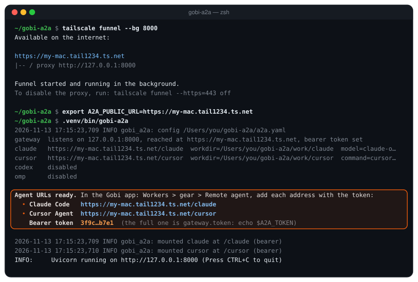
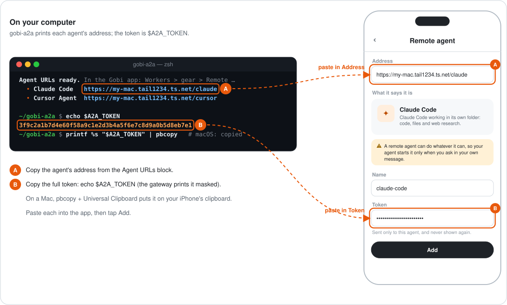
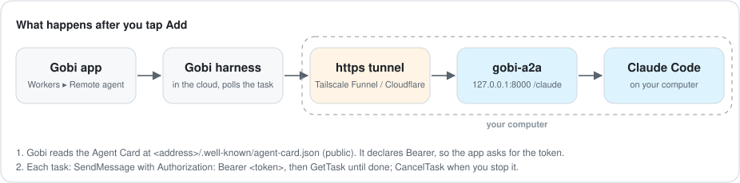
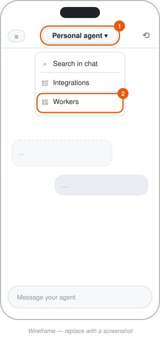
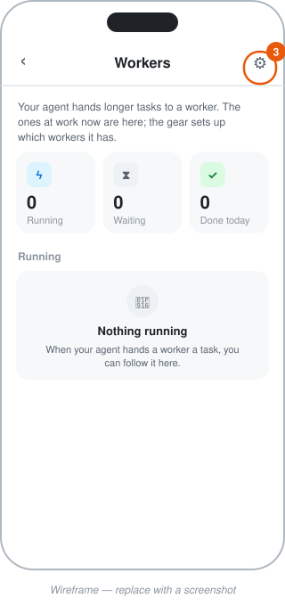
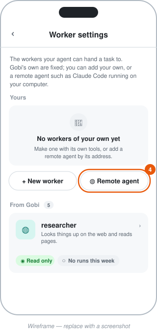
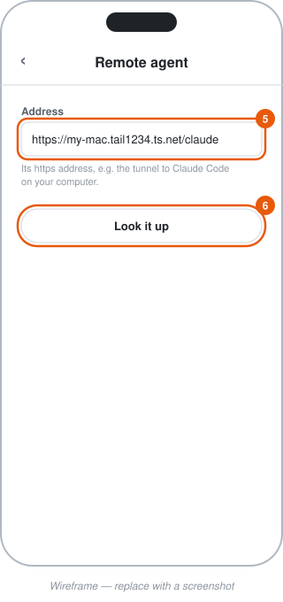
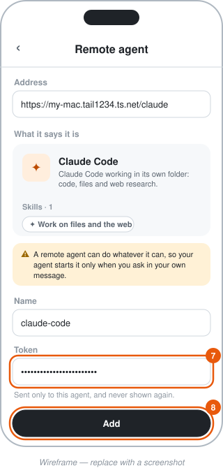
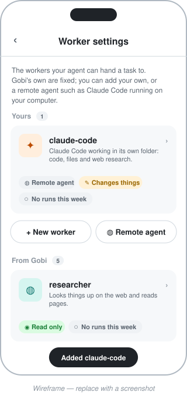
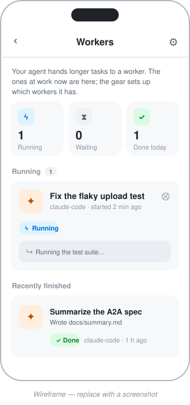

# Connecting to Gobi App

A screen-by-screen walkthrough: from a running gateway on your computer to a **Remote agent** worker in the Gobi app.
It assumes the gateway is installed and reachable through a tunnel ([Quick start](../README.md#30-second-quick-start)).
If something does not work, see [troubleshooting.md](troubleshooting.md).

**Contents**

- [What you need](#what-you-need)
- [A public https address: choosing a tunnel](#a-public-https-address-choosing-a-tunnel)
- [On your computer: the address and the token](#on-your-computer-the-address-and-the-token)
- [From the terminal to the app](#from-the-terminal-to-the-app)
- [How the pieces connect](#how-the-pieces-connect)
- [Step by step](#step-by-step)
- [Using it](#using-it)
- [How Gobi Harness connects](#how-gobi-harness-connects)

## What you need

Add each agent to your Gobi personal agent as a **Remote agent** worker. You need two things, and both come from the
terminal:

| | Value | Example |
|---|---|---|
| **A · Address** | `<A2A_PUBLIC_URL>/<agent>`, printed by `gobi-a2a` under *Agent URLs ready* | `https://my-mac.tail1234.ts.net/claude` |
| **B · Token** | the gateway's bearer token, `$A2A_TOKEN` (made by `gobi-a2a token`) | `3f9c2a1b…5d8eb7e1` (48 hex characters) |

## A public https address: choosing a tunnel

Gobi's harness runs in the cloud and only calls public `https://` addresses, so port 8000 on your machine needs a
tunnel.

**Tailscale Funnel (recommended): a permanent HTTPS address on your tailnet.**

```sh
tailscale funnel --bg 8000                # https://<machine>.<tailnet>.ts.net -> localhost:8000, kept running
tailscale funnel status                   # prints the address
```

- The address is your machine's MagicDNS name, with a real certificate, and it **never changes**, so the worker's
  address in the Gobi app stays valid across restarts and reboots.
- The first run asks you to turn on HTTPS and Funnel for the tailnet (one click in the admin console). `--bg` keeps it
  up until `tailscale funnel --bg 8000 off`. Without `--bg` it runs in the foreground, exactly `tailscale funnel 8000`.
- Funnel is the public half of Tailscale. The machine stays on your private tailnet, so you can also reach the
  gateway from your other devices at the same name. `tailscale serve --bg 8000` exposes it to the tailnet **only**:
  fine for your own A2A clients, but Gobi cannot reach a tailnet-only address.

**Cloudflare Tunnel: free, no account, no interstitial pages.**

```sh
cloudflared tunnel --url http://localhost:8000    # prints https://<random-words>.trycloudflare.com
```

- Nothing to sign up for, nothing to pay, and no browser warning page in front of your agents (unlike ngrok's free
  plan): the Agent Card and every call reach the gateway as sent.
- This *quick tunnel* gets a new random address each time it starts, so update `A2A_PUBLIC_URL` and the worker in
  the app after each restart. Quick tunnels also do not carry Server-Sent Events, so `SendStreamingMessage` and
  `SubscribeToTask` will not work through one. The Gobi harness only polls, so it does not need them.
- For a fixed address on your own domain, with streaming, use a
  [named tunnel](https://developers.cloudflare.com/cloudflare-one/networks/connectors/cloudflare-tunnel/) instead
  (also free).

Any other https tunnel works the same way, ngrok included. Start the gateway with `A2A_PUBLIC_URL` set to the
tunnel's address: the Agent Cards name it as where to send work.

## On your computer: the address and the token

Start the tunnel, then the gateway. When the gateway starts, it prints the configuration, then an **Agent URLs ready**
block that lists each enabled agent's address and the token, masked:

<p align="center"></p>

The same session as text (here with `cursor` enabled as well as `claude`):

```console
~/gobi-a2a $ tailscale funnel --bg 8000
Available on the internet:

https://my-mac.tail1234.ts.net
|-- / proxy http://127.0.0.1:8000

Funnel started and running in the background.
To disable the proxy, run: tailscale funnel --https=443 off

~/gobi-a2a $ export A2A_PUBLIC_URL=https://my-mac.tail1234.ts.net
~/gobi-a2a $ .venv/bin/gobi-a2a
2026-11-13 17:15:23,709 INFO gobi_a2a: config /Users/you/gobi-a2a/a2a.yaml
gateway  listens on 127.0.0.1:8000, reached at https://my-mac.tail1234.ts.net, bearer token set
claude   https://my-mac.tail1234.ts.net/claude  workdir=/Users/you/gobi-a2a/work/claude  model=claude-opus-5-5 effort=- permission_mode=default max_turns=none
cursor   https://my-mac.tail1234.ts.net/cursor  workdir=/Users/you/gobi-a2a/work/cursor  command=cursor-agent
codex    disabled
omp      disabled
copilot  disabled

Agent URLs ready. In the Gobi app: Workers > gear > Remote agent, add each address with the token:
  • Claude Code   https://my-mac.tail1234.ts.net/claude
  • Cursor Agent  https://my-mac.tail1234.ts.net/cursor
    Bearer token  3f9c…b7e1  (the full one is gateway.token: echo $A2A_TOKEN)
2026-11-13 17:15:23,709 INFO gobi_a2a: mounted claude at /claude (bearer)
2026-11-13 17:15:23,710 INFO gobi_a2a: mounted cursor at /cursor (bearer)
INFO:     Started server process [81533]
INFO:     Waiting for application startup.
INFO:     Application startup complete.
INFO:     Uvicorn running on http://127.0.0.1:8000 (Press CTRL+C to quit)
```

- `gobi-a2a check` prints the same configuration and Agent URLs block without starting anything, so you can run it
  again later to see the addresses.
- The gateway only prints the token **masked** (first and last four characters), so it does not end up in logs or a
  shared screen. Use the masked form to check that you are copying the right token. The full token is
  `$A2A_TOKEN` in the shell where you started the gateway. An agent with its own `token:` in `a2a.yaml` shows its own
  masked token on its line.
- If `A2A_PUBLIC_URL` is not set, the block lists `http://127.0.0.1:8000/...` addresses and ends with
  `! http://127.0.0.1:8000 is not https: Gobi only calls public https addresses`. Set it to the tunnel's address and
  restart the gateway.
- Tailscale's own wording differs a little between versions. What matters is the `https://…ts.net` line, which is
  your `A2A_PUBLIC_URL`. `tailscale funnel status` prints it again.

Before you open the app, check from a second terminal that the Agent Card answers through the tunnel. If this
fails, the app's look-up will fail the same way:

```console
~/gobi-a2a $ curl -s https://my-mac.tail1234.ts.net/claude/.well-known/agent-card.json | python3 -m json.tool | head -3
{
    "name": "Claude Code",
    "description": "Claude Code working in its own folder: code, files and web research.",
```

## From the terminal to the app

<p align="center"></p>

1. **A · Copy the address.** In the *Agent URLs ready* block, select the agent's address, e.g.
   `https://my-mac.tail1234.ts.net/claude`, and copy it. In the app, paste it into **Address** on the **Remote agent**
   screen ([step 5](#step-by-step)) and tap **Look it up**.
2. **B · Copy the token** in full. It is never printed by the gateway, so print it yourself:

   ```console
   ~/gobi-a2a $ echo $A2A_TOKEN
   3f9c2a1b7d4e60f58a9c1e2d3b4a5f6e7c8d9a0b5d8eb7e1
   ~/gobi-a2a $ printf %s "$A2A_TOKEN" | pbcopy        # macOS: on the clipboard, without a trailing newline
   ```

   In the app, paste it into **Token** ([step 7](#step-by-step)) and tap **Add**.
3. **Getting it onto the phone.** With a Mac and an iPhone on the same Apple Account, *Universal Clipboard* makes
   what `pbcopy` copied available to paste on the phone. Otherwise use your password manager, or show the token as a
   QR code and scan it with the phone's camera: `qrencode -t ansiutf8 "$A2A_TOKEN"` (`brew install qrencode`). Do not
   send the token through chat or email: anyone who has it and the address can run your agents.
4. Do the same for each other address in the block (`/cursor`, ...). The token is the same unless that agent has
   its own.

## How the pieces connect

<p align="center"></p>

## Step by step

The numbers match the callouts on the screens below. The screens are wireframes of the app's Workers pages
([gobi-app#1147](https://github.com/gobi-ai/gobi-app/pull/1147)); [images/README.md](images/README.md) says how to
swap in real screenshots.

**Open Workers from your personal agent**

1. Open the **Personal agent** chat and tap the **title pill** at the top center (it shows your agent's name, or
   *Personal agent*). The agent's menu opens under it.
2. Tap **Workers**. It is only in the menu of your own personal agent chat.
3. On **Workers**, tap the **gear** at the top right: **Worker settings**.
4. Under **Yours**, tap **Remote agent**.

<table>
  <tr>
    <td align="center"><br><sub>1–2 · Title pill ▸ Workers</sub></td>
    <td align="center"><br><sub>3 · Workers ▸ gear</sub></td>
    <td align="center"><br><sub>4 · Worker settings ▸ Remote agent</sub></td>
  </tr>
</table>

**Add the agent**

5. In **Address**, paste the agent's address (**A** from the terminal): `https://<machine>.<tailnet>.ts.net/claude`
   with Tailscale Funnel, or `https://<random-words>.trycloudflare.com/claude` with a Cloudflare quick tunnel. Include
   the agent's path (`/claude`, `/cursor`, ...): the bare domain is the gateway itself, not an agent, and has no Agent
   Card.
6. Tap **Look it up**. Gobi reads the agent's public Agent Card and shows **What it says it is**: *Claude Code*, its
   description and skill, and a **Changes things** badge. A remote agent can do whatever it can on your computer, so
   your agent starts it only when you ask for it in your own message.
7. Check the **Name** (filled in from the card, e.g. `claude-code`; lowercase letters, digits and hyphens, starting
   with a letter). It is how your agent and the Workers page refer to it. Then paste your **Token** (**B**), the value
   of `$A2A_TOKEN`. It is sent only to this agent and never shown again. The Token field appears because the card
   declares HTTP Bearer; with `no_auth: true` there is none.
8. Tap **Add**. A toast says *Added claude-code*, and the agent is listed under **Yours** in Worker settings.

<table>
  <tr>
    <td align="center"><br><sub>5–6 · Address ▸ Look it up</sub></td>
    <td align="center"><br><sub>7–8 · Token ▸ Add</sub></td>
    <td align="center"><br><sub>Added under Yours</sub></td>
  </tr>
</table>

Repeat steps 4 to 8 for each other agent you enabled (`/cursor`, `/codex`, `/omp`, `/copilot`), with the same token unless you
gave that agent its own `token:` in `a2a.yaml`.

## Using it

- **Ask for it by name.** Your agent hands work to a remote agent only when your own message asks for it, for example
  *"Have claude-code fix the flaky upload test in ~/src/app"*. Each task is one A2A `SendMessage`; Gobi then polls it
  with `GetTask` (see [How Gobi Harness connects](#how-gobi-harness-connects)).
- **Watch it on Workers.** While it works, the task is under **Running**, with the worker's name, when it started and
  its latest progress line. Tapping a running task asks *Stop this worker?*; **Stop** sends `CancelTask`. The last
  five that ended are under **Recently finished**, each with how it ended and its summary.
- **Edit or remove it** from **Worker settings**: tap the worker. Its page shows this week's runs. **Enter it again**
  replaces the token, **Read its card again** saves and re-reads the card (after you rename the agent or change its
  description in `a2a.yaml`), and **Remove** deletes it. The address cannot be edited: if it changes (a Cloudflare
  quick tunnel gets a new one on each start), remove the worker and add it again with the new address.

<p align="center"><br><sub>Workers while claude-code is at work</sub></p>

## How Gobi Harness connects

The harness (`gobi-harness/engine/a2a.py`) is given an address and nothing else:

1. It reads the **Agent Card** at `<address>/.well-known/agent-card.json`, for example
   `https://my-mac.tail1234.ts.net/claude/.well-known/agent-card.json`. Cards are **public**, so the harness can read
   one before it has a credential. Each card declares HTTP Bearer, so the app asks for the token.
2. It sends work to the JSON-RPC URL the card names. The gateway always names `<public_url>/<agent>/` (with the
   trailing slash, because the harness does not follow redirects). Each brief is one A2A message (protocol 1.0,
   `SendMessage` with `returnImmediately`). The harness then polls the task with `GetTask`, sends steers to the same
   task, and calls `CancelTask` on kill.
3. The final status message's metadata carries the run's cost (`cost_usd`, `usage`, `turns`, `model`, `effort`), and
   the harness adds it to the worker's use.

`public_url` must therefore be the URL the harness actually reaches, meaning your tunnel's `https://` URL. The harness
only talks to public https addresses. A Tailscale Funnel address never changes. If yours does (a Cloudflare quick
tunnel gets a new one on each start), update `A2A_PUBLIC_URL`, restart, and add the worker again with the new address.

The exact calls, headers and limits the harness uses (60 s per call, 2 MB per answer, polling every 2 to 15 s) are in
[protocol.md §12.1](protocol.md#121-what-a-gobi-harness-needs-from-an-agent).
